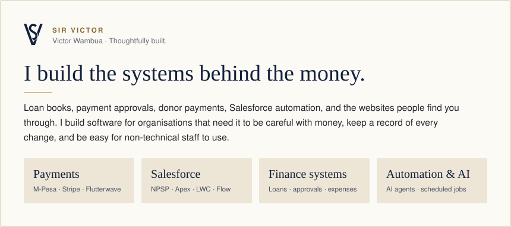

> Most of my code is private because it handles real people's money or belongs to clients. The cards below describe what each project does.

## Selected work

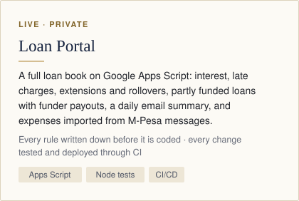
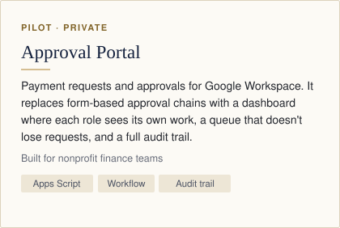

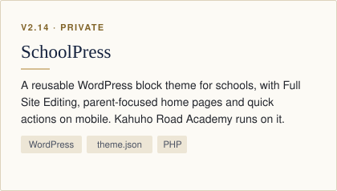
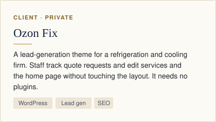

## Salesforce for a nonprofit (NPSP)

I build and run the Salesforce org for a children's charity in Kenya and its US fundraising arm. I've merged 69 pull requests there. Every change gets a test deploy in CI before merge, then deploys to the sandbox automatically.

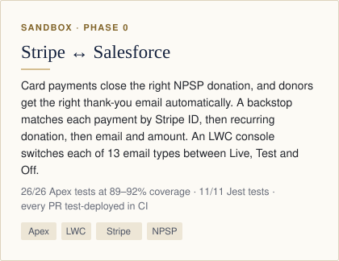
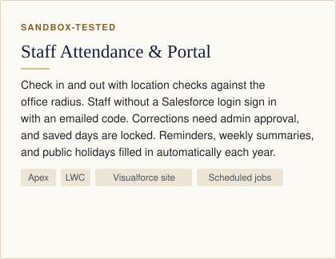

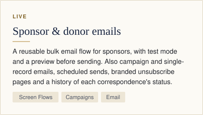
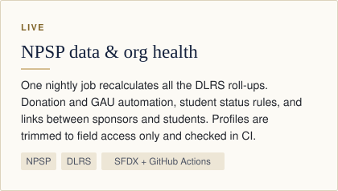

## Automation & AI

I build AI agents and scheduled automations that do the follow-up work. They follow the same rules as my finance systems: they only read by default, test their data before publishing, and send nothing without approval.

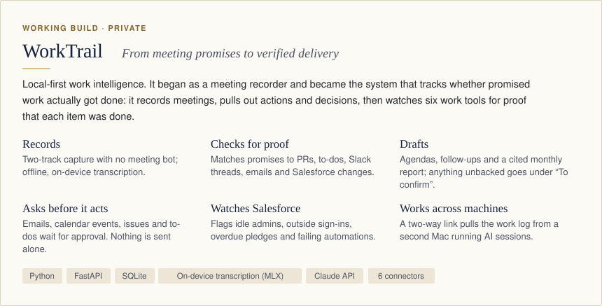

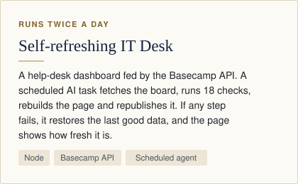
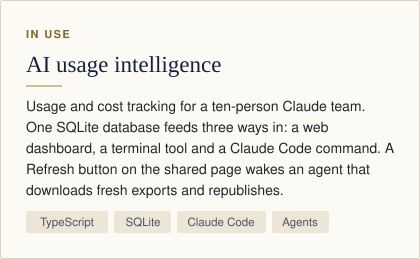

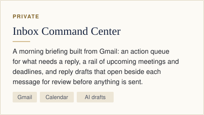
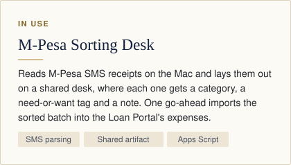

## How I work

- **Rules written down first.** Every money rule is agreed and numbered before it's coded.
- **Tested, then shipped.** Every change goes through a pull request and CI before it deploys.
- **A record of every change.** Every save is logged, and every change can be traced to who made it and why.
- **Guides for real users.** Each app ships with a plain-language guide that has screenshots, plus a change log.

## Stack

     

**Next:** Salesforce Administrator and Platform Developer I certifications.  
**Open to:** payment integrations and nonprofit tech projects.

**Reach me:** [victorwambua004@gmail.com](mailto:victorwambua004@gmail.com) · [LinkedIn](https://www.linkedin.com/in/victor-wambua)
