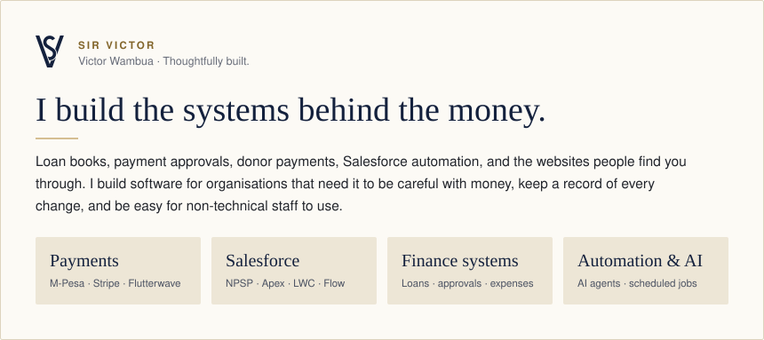

> Most of my code is private because it handles real people's money or belongs to clients. The cards below describe what each project does, and **[the case studies](https://github.com/Victor-Wambua/case-studies)** go deeper: the problem, the design, how each is tested, and screenshots on made-up data. The **open-source builds** below are public, so you can run them and read their tests.

## Open-source builds

Twenty public repositories, each with tests, screenshots and a written case study. They run on made-up data and simulated payments, and each README says what has not been verified. Six of them first:

<a href="https://github.com/Victor-Wambua/daraja-php">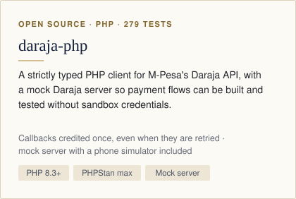</a>
<a href="https://github.com/Victor-Wambua/chama-ledger">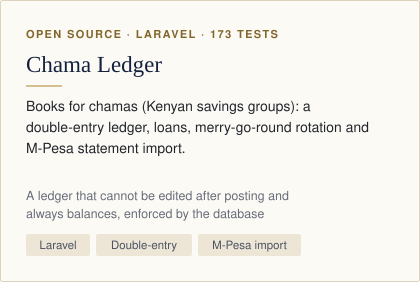</a>

<a href="https://github.com/Victor-Wambua/mpesa-ledger">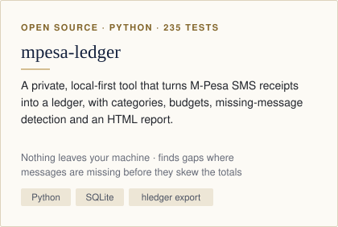</a>
<a href="https://github.com/Victor-Wambua/clinic-queue">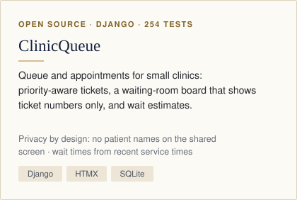</a>

<a href="https://github.com/Victor-Wambua/authkit">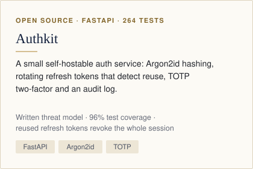</a>
<a href="https://github.com/Victor-Wambua/msingi-ui">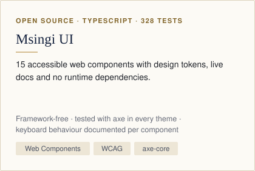</a>

<b>The other fourteen</b>

| Build | What it does | Look |
|---|---|---|
| [**tiketi**](https://github.com/Victor-Wambua/tiketi) | Seat booking that cannot double-book a seat, with signed QR tickets and an offline gate scanner. | [Case study](https://github.com/Victor-Wambua/tiketi/blob/main/docs/CASE-STUDY.md) |
| [**duka-storefront**](https://github.com/Victor-Wambua/duka-storefront) | Mobile-first shop with an M-Pesa STK push checkout built as a tested state machine. | [Live demo](https://victor-wambua.github.io/duka-storefront/) · [Case study](https://github.com/Victor-Wambua/duka-storefront/blob/main/docs/CASE-STUDY.md) |
| [**duka-admin**](https://github.com/Victor-Wambua/duka-admin) | Shop back-office: orders, stock ledger, M-Pesa payment matching and an end-of-day close. | [Case study](https://github.com/Victor-Wambua/duka-admin/blob/main/docs/CASE-STUDY.md) |
| [**kikao**](https://github.com/Victor-Wambua/kikao) | Realtime chat for unreliable networks: offline-first, exactly-once delivery. | [Case study](https://github.com/Victor-Wambua/kikao/blob/main/docs/CASE-STUDY.md) |
| [**stockroom**](https://github.com/Victor-Wambua/stockroom) | Offline stock-taking: scan, count and merge several phones without a server. | [Live demo](https://victor-wambua.github.io/stockroom/) · [Case study](https://github.com/Victor-Wambua/stockroom/blob/main/docs/CASE-STUDY.md) |
| [**maktaba**](https://github.com/Victor-Wambua/maktaba) | School library desk, with fines that follow the school calendar. | [Case study](https://github.com/Victor-Wambua/maktaba/blob/main/docs/CASE-STUDY.md) |
| [**shule-timetable**](https://github.com/Victor-Wambua/shule-timetable) | Clash-free school timetables from a constraint solver, changing few lessons when a teacher leaves. | [Sample timetables](https://victor-wambua.github.io/shule-timetable/) · [Case study](https://github.com/Victor-Wambua/shule-timetable/blob/main/docs/CASE-STUDY.md) |
| [**fundi-finder**](https://github.com/Victor-Wambua/fundi-finder) | Marketplace for local artisans, where a review needs a code from a real job. | [Case study](https://github.com/Victor-Wambua/fundi-finder/blob/main/docs/CASE-STUDY.md) |
| [**mama-mboga**](https://github.com/Victor-Wambua/mama-mboga) | Greengrocer ordering, with a parser for pasted WhatsApp orders and a credit ledger. | [Case study](https://github.com/Victor-Wambua/mama-mboga/blob/main/docs/CASE-STUDY.md) |
| [**jibu**](https://github.com/Victor-Wambua/jibu) | English and Swahili FAQ engine that answers only from approved content. | [Case study](https://github.com/Victor-Wambua/jibu/blob/main/docs/CASE-STUDY.md) |
| [**algorithm-atlas**](https://github.com/Victor-Wambua/algorithm-atlas) | Step-through visual atlas of 14 algorithms, working offline. | [Live demo](https://victor-wambua.github.io/algorithm-atlas/) · [Case study](https://github.com/Victor-Wambua/algorithm-atlas/blob/main/docs/CASE-STUDY.md) |
| [**dockerfile-doctor**](https://github.com/Victor-Wambua/dockerfile-doctor) | Dockerfile and compose linter with 62 rules, SARIF output and a GitHub Action. | [Playground](https://victor-wambua.github.io/dockerfile-doctor/) · [Case study](https://github.com/Victor-Wambua/dockerfile-doctor/blob/main/docs/CASE-STUDY.md) |
| [**devbox-bootstrap**](https://github.com/Victor-Wambua/devbox-bootstrap) | Idempotent macOS dev-machine setup with plan, apply and doctor commands. | [Docs](https://victor-wambua.github.io/devbox-bootstrap/) · [Case study](https://github.com/Victor-Wambua/devbox-bootstrap/blob/main/docs/CASE-STUDY.md) |
| [**donor-retention-lab**](https://github.com/Victor-Wambua/donor-retention-lab) | Lapse-risk analysis for nonprofit donors, on synthetic data. | [Sample report](https://victor-wambua.github.io/donor-retention-lab/) · [Case study](https://github.com/Victor-Wambua/donor-retention-lab/blob/main/docs/CASE-STUDY.md) |

## Selected work

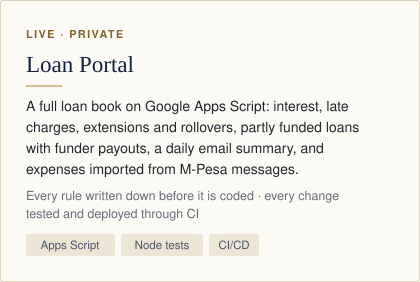
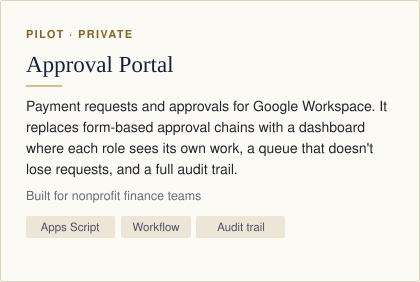

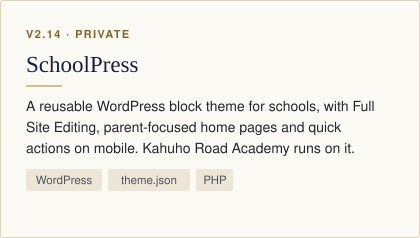
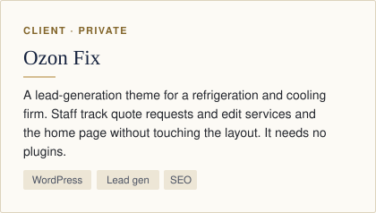

## Salesforce for a nonprofit (NPSP)

I build and run the Salesforce org for a children's charity in Kenya and its US fundraising arm. I've merged 69 pull requests there. Every change gets a test deploy in CI before merge, then deploys to the sandbox automatically.

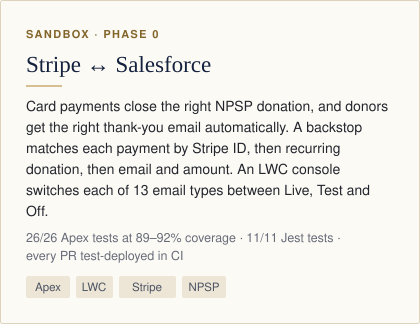
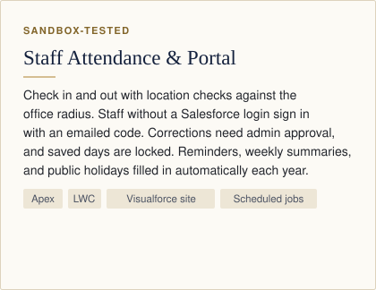

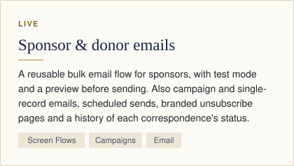
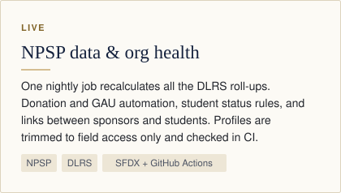

## Automation & AI

I build AI agents and scheduled automations that do the follow-up work. They follow the same rules as my finance systems: they only read by default, test their data before publishing, and send nothing without approval.

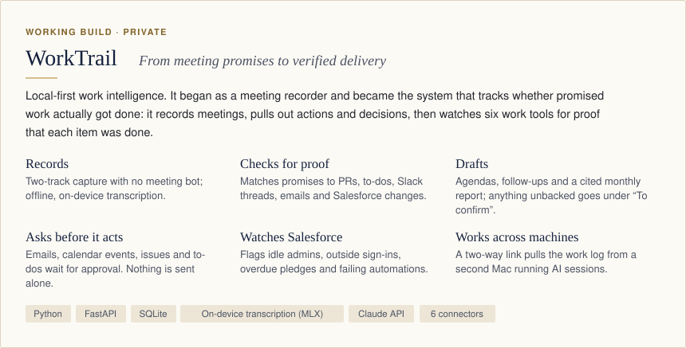

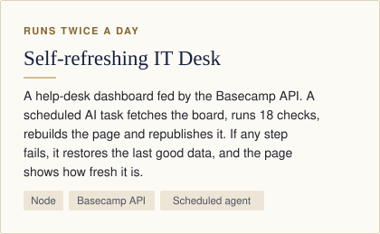
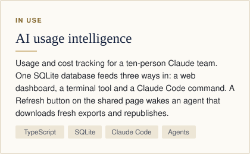

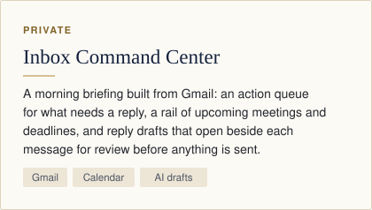
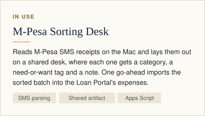

## How I work

- **Rules written down first.** Every money rule is agreed and numbered before it's coded.
- **Tested, then shipped.** Every change goes through a pull request and CI before it deploys.
- **A record of every change.** Every save is logged, and every change can be traced to who made it and why.
- **Guides for real users.** Each app ships with a plain-language guide that has screenshots, plus a change log.

## Stack

      

**Next:** Salesforce Administrator and Platform Developer I certifications.  
**Open to:** payment integrations and nonprofit tech projects.

**Reach me:** [victorwambua004@gmail.com](mailto:victorwambua004@gmail.com) · [LinkedIn](https://www.linkedin.com/in/victor-wambua) · [Portfolio](https://victor-wambua.github.io/victor-portfolio/) · [Case studies](https://github.com/Victor-Wambua/case-studies) · [Download CV (PDF)](https://victor-wambua.github.io/victor-portfolio/assets/cv/Victor-Wambua-CV.pdf)
